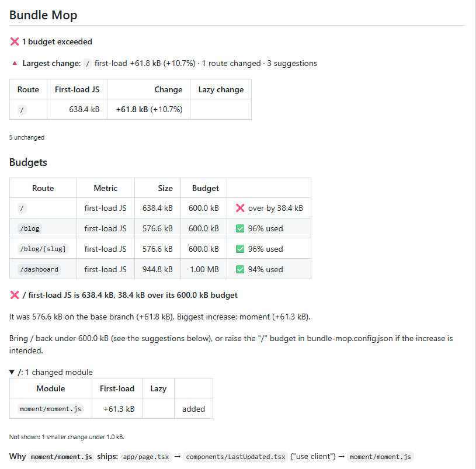

<p align="center">
  
</p>

<h1 align="center">Bundle Mop</h1>

<p align="center">
  <strong>See why your pull request made your Next.js app heavier, and how to fix it.</strong>
</p>

<p align="center">
  <a href="https://www.npmjs.com/package/bundle-mop"></a>
  <a href="https://github.com/marketplace/actions/bundle-mop"></a>
  <a href="https://github.com/yosuva-rv/bundle-mop/actions/workflows/ci.yml"></a>
  <a href="LICENSE"></a>
</p>

---

Bundle Mop is a GitHub Action (and CLI) for **Next.js 16** apps. On every pull request it posts one comment that
answers three questions:

- 📦 **What changed?** Which pages now ship more (or less) JavaScript.
- 🔍 **Why?** The exact import chain, e.g. `page.tsx → LastUpdated.tsx ("use client") → moment`.
- 🧹 **How do I fix it?** Concrete suggestions, with code you can copy.

<p align="center">
  <a href="https://github.com/yosuva-rv/bundle-mop-demo/pull/1">
    
  </a>
  <br>
  <sub>A real comment from the <a href="https://github.com/yosuva-rv/bundle-mop-demo">demo app</a>: <a href="https://github.com/yosuva-rv/bundle-mop-demo/pull/1">adding moment</a> · <a href="https://github.com/yosuva-rv/bundle-mop-demo/pull/2">lazy-loading a chart (−363 kB)</a></sub>
</p>

## Quick start

Add this file to your repository and open a pull request. That's it.

```yaml
# .github/workflows/bundle-mop.yml
name: Bundle Mop
on: pull_request

permissions:
  contents: read
  pull-requests: write

jobs:
  bundle-mop:
    runs-on: ubuntu-latest
    steps:
      - uses: actions/checkout@v7
      - uses: actions/setup-node@v7
        with:
          node-version: 22
      - run: npm ci                   # or pnpm / yarn / bun
      - uses: yosuva-rv/bundle-mop@v0
        # with:
        #   working-directory: apps/web   # if your app isn't at the repo root
```

**Requires Next.js 16.4 or newer.** It reads Next's own bundle analyzer (`next analyze`); no extra build plugin needed.

## Size budgets (optional)

Want PRs to fail when a page gets too heavy? Add `bundle-mop.config.json` next to your app:

```json
{
  "budgets": [
    { "route": "/", "firstLoad": "150 kB" },
    { "route": "/**", "firstLoad": "300 kB" }
  ]
}
```

A PR that pushes a page over its budget fails the check. A page that was *already* over budget only gets a warning,
so nobody is blocked by someone else's code. [More about budgets →](docs/budgets.md)

## What it suggests

| When | Suggestion |
|---|---|
| A heavy library arrives (moment, full lodash, jQuery…) | A lighter alternative, e.g. moment → dayjs, date-fns or `Intl` |
| A big package lands in a client component | Lazy-load it with `next/dynamic` (ready-to-paste snippet) |
| A formatting library runs in the browser only because of `"use client"` | Do that work in a Server Component |
| Something that was lazy-loaded is now loaded up front | Find the removed `next/dynamic` or new import |
| The same package ships in two versions | Align the versions |
| Many files of one package ship | Import subpaths or use `optimizePackageImports` |

All suggestions come from fixed rules: **no AI, no API key, no data leaves your CI.** [All rules →](docs/rules.md)

## Try it locally in one command

Inside your Next.js app, on your branch:

```sh
npx bundle-mop compare
```

It compares your code (uncommitted changes included) with `main`, the same way a pull request would, and
prints the report. Your files aren't touched: the base is analyzed in a temporary checkout, and the result is cached,
so the next run takes seconds.

Options: `--base <branch>`, `--format markdown|json`, `--config <file>`, `--verbose`. Run `npx bundle-mop compare --help`
for all of them. Already have two `next analyze export` files? Use `npx bundle-mop diff base.jsonl pr.jsonl`.

## FAQ

**Does it slow down my CI?** It runs `next analyze` twice (your branch and the base) plus one extra install for the
base. No `next build`. On a small app it takes about a minute.

**What about pull requests from forks?** GitHub gives fork PRs a read-only token, so the comment can't be posted. The
report still appears in the job summary.

**Why sizes in raw kB, not gzip?** Raw minified sizes from the analyzer are exact. Its gzip numbers are estimates that
can be up to ~2× too high, so they're shown as estimates and never used for budgets.

**Does it work with Next.js 14 or 15?** No. It needs the Turbopack analyzer export that shipped in Next.js 16.4.

## Learn more

- [GitHub Action: inputs, outputs, forks and security](docs/action.md)
- [Budgets](docs/budgets.md) · [Rules](docs/rules.md) · [How the analyzer data works](docs/analyze-format.md)
- [Changelog](CHANGELOG.md) · [Contributing](CONTRIBUTING.md)

## License

[MIT](LICENSE)
