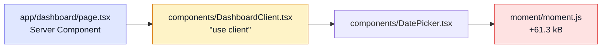

<!-- bundle-mop:comment -->
## Bundle Mop

🔺 **Largest change:** `/dashboard` first-load +61.3 kB (+10.8%) · 1 route changed · 3 suggestions

| Route | First-load JS | Change | Lazy change |
|---|---:|---:|---:|
| `/dashboard` | 630.5 kB | **+61.3 kB** (+10.8%) |  |

<sub>3 unchanged</sub>

<details open><summary><b>/dashboard</b>: 1 changed module</summary>

| Module | First-load | Lazy | |
|---|---:|---:|---|
| `moment/moment.js` | +61.3 kB |  | added |

<sub>Not shown: 2 smaller changes under 1.0 kB.</sub>

**Why `moment/moment.js` ships:** `app/dashboard/page.tsx` → `components/DashboardClient.tsx` ("use client") → `components/DatePicker.tsx` → `moment/moment.js`

</details>

### Suggestions

#### ⚠️ moment adds 61.3 kB to first-load JS
<sub>heavy-package · `/dashboard`</sub>

moment is a legacy project in maintenance mode, and its single object API cannot be tree-shaken. Imported by components/DatePicker.tsx.

Use dayjs (similar API), date-fns (tree-shakeable; optimized by Next by default), or Intl.DateTimeFormat for plain formatting.

**💡 Lazy-load components/DatePicker.tsx to keep moment out of first-load JS** <sub>lazy-load-candidate</sub>

moment adds 61.3 kB to first-load JS. Imported by components/DatePicker.tsx.

Load components/DatePicker.tsx with next/dynamic so it (and moment) is fetched only when it renders. That moves about 61.6 kB out of first-load JS on this route.

```tsx
// components/DashboardClient.tsx
import dynamic from 'next/dynamic';
const DatePicker = dynamic(() => import('./DatePicker'));
```

This assumes the file's default export is the component; for a named export use `import('…').then((m) => m.Name)`.

[Docs](https://nextjs.org/docs/app/guides/lazy-loading)

**💡 moment runs in the browser because of "use client" in components/DashboardClient.tsx** <sub>server-candidate</sub>

moment reaches the browser through the "use client" boundary in components/DashboardClient.tsx. Imported by components/DatePicker.tsx. Server Component code isn't sent to the browser.

If the moment work only formats or parses data, do it in a Server Component and pass the result to the client component as props. Keep only the interactive part behind "use client".

[Docs](https://nextjs.org/docs/app/getting-started/server-and-client-components)

<details open><summary>Import chain</summary>



`app/dashboard/page.tsx` → `components/DashboardClient.tsx` ("use client") → `components/DatePicker.tsx` → `moment/moment.js`

</details>

<sub>Minified client JS from <code>next analyze</code>; gzip figures are estimates. Changes under the noise threshold are hidden. Generated by <a href="https://github.com/yosuva-rv/bundle-mop">Bundle Mop</a>.</sub>
